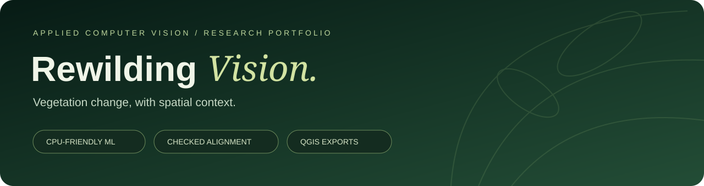
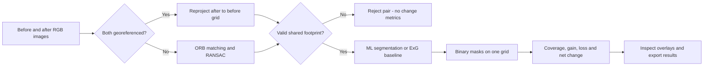
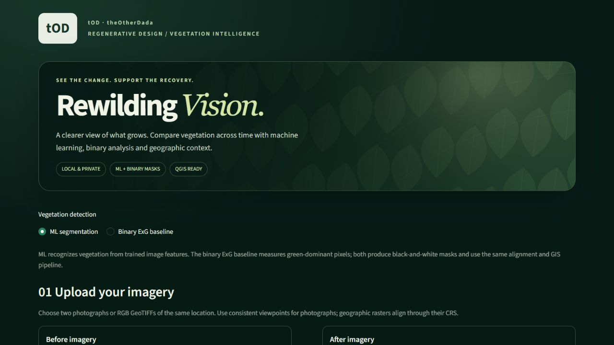

<p align="center"></p>

# Rewilding Vision

**Understand what grew, what was lost, and whether two images can be compared reliably.**

[](https://github.com/mhmmdtuka704-blip/rewilding-vision/actions/workflows/tests.yml)


This project grew out of my internship at **theOtherDada (tOD)**. The first version counted green pixels. That was useful, but a shifted camera or a dark patch of vegetation could make a comparison misleading. I kept the useful parts of that prototype and built a more careful workflow around them: trained vegetation segmentation, alignment checks, a shared comparison footprint, and outputs that can be inspected in QGIS.

It is a **local research application**, built to run on a CPU laptop. It includes the original color baseline so users can inspect how a simple method differs from the learned model. It is not a claim that photographs alone measure ecological recovery.

**[Quick start](#run-it-locally) · [Architecture](docs/architecture.md) · [Model card](docs/model-card.md) · [Dataset card](docs/data-card.md) · [Results](docs/results.md) · [Development journey](docs/development.md)**

## What it does

| Need | What the application provides |
|---|---|
| Find vegetation beyond a fixed green threshold | SegFormer-B0 with a small supervised RUGD segmentation adapter |
| Check the original approach | Explicit **Binary ExG baseline**, with its threshold recorded |
| Handle modest camera movement | ORB + RANSAC similarity alignment, with rejection gates |
| Avoid comparing different footprints | One shared valid area for before, after, gain and loss |
| Inspect the result | Binary masks, overlays, a gain/loss map and an alignment view |
| Work with geographic imagery | RGB GeoTIFF reprojection, nodata handling and QGIS-ready rasters |
| Take results elsewhere | JSON measurements, PNG report and a ZIP of masks/maps/GeoTIFFs |

The engineering value is in connecting these steps correctly. A segmentation score is not enough if the camera moved, the valid areas differ, or the exported raster has the wrong transform.

## The workflow



[How the modules fit together →](docs/architecture.md)

## Results I can substantiate

The deployed ML model was evaluated on **48 held-out RUGD images from four sequences**, with **18,162,203 valid pixels**. Training and validation used other sequences. These are segmentation results on a bounded ground-view subset, not TOD field-change accuracy.

| Metric | Held-out result |
|---|---:|
| Vegetation Dice / F1 | **93.98%** |
| Pixel accuracy | **90.97%** |
| Vegetation IoU | **88.64%** |
| Precision / recall | 91.72% / 96.36% |
| Coverage MAE | 5.73 percentage points |
| Mean measured CPU inference | 0.47 seconds/image |

**F1, pixel accuracy and IoU are different metrics. This is not 94% IoU or guaranteed accuracy on arbitrary imagery.** See the [full results and limitations](docs/results.md), [raw test records](benchmarks/test_metrics.json), and [training history](benchmarks/training_history.json).

Training optimized only a **514-parameter residual head** on frozen pretrained features. The run used 160 training images, 36 validation images, five epochs, and about 3.5 minutes of CPU time. Validation IoU improved from 92.52% to 93.20%; the test split was not used to select the checkpoint.

## Run it locally

Python **3.12 or 3.13** is supported. The original measured run used Windows, Python 3.13 and a CPU-only PyTorch installation.

```bash
git clone https://github.com/mhmmdtuka704-blip/rewilding-vision.git
cd rewilding-vision
python -m venv .venv
```

Activate the environment:

```powershell
# Windows PowerShell
.\.venv\Scripts\Activate.ps1
```

```bash
# macOS / Linux
source .venv/bin/activate
```

Install CPU PyTorch and the application:

```bash
python -m pip install --upgrade pip
python -m pip install torch --index-url https://download.pytorch.org/whl/cpu
python -m pip install -e ".[dev]"
```

Download the **pinned, checksum-verified** pretrained weights after reviewing their [research/evaluation terms](THIRD_PARTY_NOTICES.md):

```bash
python scripts/setup_model.py
python -m streamlit run app.py
```

Open **http://localhost:8501**. On Windows, after setup, double-click **`OPEN_IN_EDGE.bat`** to start the application and open Microsoft Edge. The **Binary ExG baseline** also works without downloading ML weights. The dataset is not required to analyze your own images.



The public preview uses decorative vector artwork and an empty upload screen; it does not expose field imagery or imply a new accuracy result.

### Use the app

1. Select **ML segmentation** or **Binary ExG baseline**.
2. Upload before/after JPG, PNG or true-color RGB GeoTIFF imagery of the same place.
3. Run the analysis. A rejected alignment produces no vegetation-change measurements.
4. Inspect the **change map**, **binary masks**, **overlays** and **valid footprint**.
5. Download the report. If the reference is georeferenced, drag the exported `gis/*.tif` files into QGIS.

Raw multispectral reflectance, DEMs and single-band class masks are not equivalent to display RGB. See [input and GIS details](docs/usage.md).

## Measurements, without ambiguous percentages

All before/after coverage, gain and loss percentages use the **same valid overlapping area**.

| Output | Meaning |
|---|---|
| Before / after coverage | Vegetation pixels divided by shared valid pixels |
| Gain / loss | Newly vegetated / lost pixels divided by shared valid pixels |
| Net change | After coverage minus before coverage, in **percentage points** |
| Relative change | Change divided by starting vegetation coverage, in **percent** |

For example, 20% → 30% coverage is **+10 percentage points** and **+50% relative change**. Relative change is `N/A` when the starting vegetation area is zero. [Exact formulas and raster encodings →](docs/usage.md)

## Test and reproduce

```bash
python -m pytest -q
python scripts/verify_app.py
python scripts/check_repository.py
```

The unit suite and default app smoke check use synthetic software fixtures: they do **not** need dataset downloads or neural weights, and do not claim to measure real-world accuracy. For a real neural pipeline smoke check after downloading weights:

```bash
python scripts/verify_app.py --ml
```

To reproduce the original experiment, review the data terms, then fetch the **recorded 244-file-pair subset**, rather than the full dataset:

```bash
python scripts/prepare_training_subset.py
python scripts/evaluate_followup.py
```

The exact manifest, sequence assignments, source revisions and SHA-256 hashes are retained. Retraining is optional; [the reproducibility guide](docs/reproducibility.md) explains the recipe and why a new test split is needed for future tuning.

## Repository map

```text
app.py                    Streamlit interface and method selection
src/rewilding_vision/      Segmentation, registration, metrics, GIS and export logic
scripts/                  Pinned acquisition, training, evaluation and verification
tests/                    Unit and regression coverage
configs/                  Registration quality gates and analysis settings
model/                    Base-model provenance + small trained adapter
data/rugd_subset/         Manifest and provenance; images are downloaded separately
benchmarks/               Recorded test, training and alignment evidence
docs/                     Architecture, model/data cards, usage and engineering decisions
.github/                  CI workflow, issue forms and contribution support
```

Large datasets, base weights, personal paths, local uploads, caches and old presentation bundles are excluded from Git history. The publishing copy is separate from the original internship working folder.

## Honest limits and next steps

This is strongest as a reproducible research and engineering project. Camera parallax, occlusion, moving objects, poor georeferencing, very small plants and unfamiliar aerial imagery can still cause errors. A synthetic darkening check is not proof of shadow invariance. There is no labeled TOD temporal pilot establishing real-site change accuracy.

The next useful experiment is a **small, carefully labeled TOD repeat-view dataset**, with independent sites reserved for testing. More training or a larger network would not, by itself, fix the problem of evaluating the wrong deployment domain.

## Context, attribution and reuse

Maintained by [@mhmmdtuka704-blip](https://github.com/mhmmdtuka704-blip), originating from an internship project at **theOtherDada (tOD)**. This repository is a personal portfolio/research presentation, not an official company product or endorsement. Development and verification used AI coding assistance; the benchmark numbers come from the retained experimental records.

The base model is NVIDIA SegFormer-B0, implemented through Hugging Face Transformers; the original dataset is **RUGD**, with a recorded convenience mirror. No dataset ownership or original model-pretraining credit is claimed.

**Public source availability is not a blanket commercial license.** See [LICENSE](LICENSE), [third-party notices](THIRD_PARTY_NOTICES.md), and the [model card](docs/model-card.md). Dataset files and corporate logo assets are not redistributed here. The small learned adapter retains the stated upstream model restrictions.

[Contributing](CONTRIBUTING.md) · [Security notes](SECURITY.md) · [Citation](CITATION.cff) · [Changelog](CHANGELOG.md)
