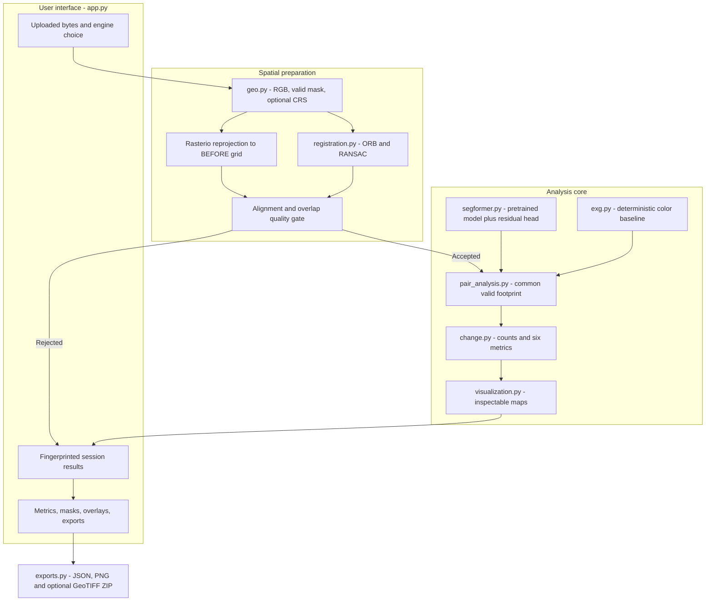
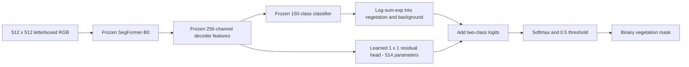

# Architecture

The application uses a narrow predictor interface: `predict(rgb) -> (binary_mask, vegetation_score)`. Spatial registration and shared-area measurements do not depend on whether the mask came from a neural model or the ExG baseline.

## Coordinate contract

The **BEFORE image is the reference grid**. AFTER masks and change rasters use that grid. A metric is computed only on the intersection of the valid source footprints, excluding nodata and partially sampled photographic warp edges.

- Ordinary photographs: ORB descriptors, Hamming matching, a ratio test and unique matches feed `estimateAffinePartial2D` with RANSAC. The estimated similarity supports translation, rotation and uniform scale. It is stored in a 3×3 matrix; that does not turn it into an unrestricted perspective homography.
- Paired GeoTIFFs: RGB and validity are reprojected into the reference CRS/grid. Source geographic accuracy is assumed and is reported explicitly; it is not advertised as ORB-verified alignment.
- Poor matching or inadequate common area returns an explanation and no change measurements. In the photographic path the rejected pair does not reach segmentation.

## Segmentation adapter

Zero initialization makes the residual head preserve the grouped pretrained probabilities before optimization. Only the correction is trained. This is supervised transfer learning on frozen features, not end-to-end retraining.

## State and deployment boundaries

The model is cached once per model signature. Uploaded assets have bounded caching. Results are keyed by both input bytes and method/model signature, so a method change cannot leave stale measurements displayed. Download controls preserve session results.

Uploads stay on the local application server. Runtime inference reads local weights; it does not call a remote inference API. Download scripts are a separate, explicit setup/reproduction step. There is no database, hosted map service or cloud-training dependency.

## Modules

| Module | Responsibility |
|---|---|
| `geo.py` | Image assets, EXIF/RGB loading, nodata, geographic grids, GeoTIFF encoding |
| `registration.py` | Photographic matching, similarity transform and quality rejection |
| `segformer.py` | Local checkpoint loading, preprocessing, residual classifier and inference |
| `exg.py` | Original normalized Excess Green method |
| `pair_analysis.py` | Alignment → common mask → predictions → change artifacts |
| `change.py` | Binary change categories and shared-denominator arithmetic |
| `exports.py` | Portable JSON/PNG/GeoTIFF result bundles |
| `visualization.py` | Mask overlays, categorical colors and report panels |
| `rugd_labels.py` | Exact source-color mapping and void handling |
| `evaluation.py`, `metrics.py` | Segmentation/coverage metrics and aggregation |
| `reproducibility.py` | Saved run metadata and JSON utilities |

Other retained modules support earlier dataset preparation/general training experiments. The actual published adapter run is defined by `scripts/train_lightweight_head.py`, not by every option available in the historical generic trainer.
