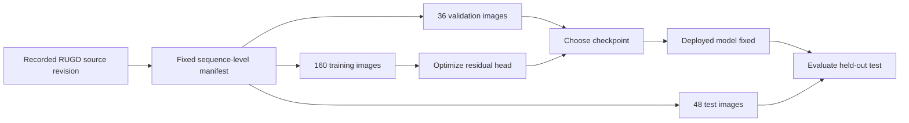

# Dataset card

## Source and bounded scope

The experiment uses **RUGD**, credited to Maggie Wigness, Sungmin Eum, John G. Rogers, David Han and Heesung Kwon, *A RUGD Dataset for Autonomous Navigation and Visual Perception in Unstructured Outdoor Environments*, IROS 2019.

Original source: <http://rugd.vision/>. Acquisition used the explicitly recorded unofficial mirror [WilliamBonilla62/RUGD](https://huggingface.co/datasets/WilliamBonilla62/RUGD). A mirror is not the dataset's author or a new license grant.

The selected subset contains **244 unique image/annotation pairs**, **183,245,437 bytes** of image/annotation data. Individual files were fetched rather than the full multi-gigabyte archive. Raw images/labels are not redistributed in Git history. The [manifest](../data/rugd_subset/manifest.csv) and [provenance](../data/rugd_subset/provenance.json) preserve exact membership, source revision and hashes.

## Label contract

The source color annotation is converted to:

- **1 vegetation:** grass, tree, bush.
- **0 background:** other known classes.
- **255 ignored:** void.

Unknown colors raise an error in strict conversion. Label resizing uses nearest-neighbor interpolation, so it cannot introduce interpolated class colors. Mulch/logs are not automatically labeled as living vegetation.

## Sequence-level split

| Split | Capture sequences | Images per sequence | Total |
|---|---|---:|---:|
| Train | park-1, park-2, park-8, trail-4, trail-5, trail-6, trail-7, trail-9, trail-15, village | 16 | 160 |
| Validation | creek, trail-3, trail-10 | 12 | 36 |
| Test | trail-11, trail-12, trail-13, trail-14 | 12 | 48 |

Selection was fixed before scoring, using uniformly spaced indices within the returned sequence file listings. Entire sequences are disjoint across splits; exact duplicate image hashes were rejected. This avoids splitting near-adjacent frames from the same sequence across training and evaluation. It does not eliminate all correlation or guarantee environmental independence.



## Download / integrity

Review upstream terms before running:

```bash
python scripts/prepare_training_subset.py
```

The public script uses the saved revision, paths and SHA-256 hashes rather than silently selecting the future contents of `main`. Cached files are also checked. Images remain local and ignored by Git.

## Limits and privacy

This is outdoor ground-view navigation imagery. It is not a TOD field survey, real before/after ecological ground truth, or an aerial deployment dataset. Four test sequences remain a small geographic/environmental sample. No public upload of user photographs, precise site coordinates, local server logs or private company documents is needed to reproduce the stated experiment.
